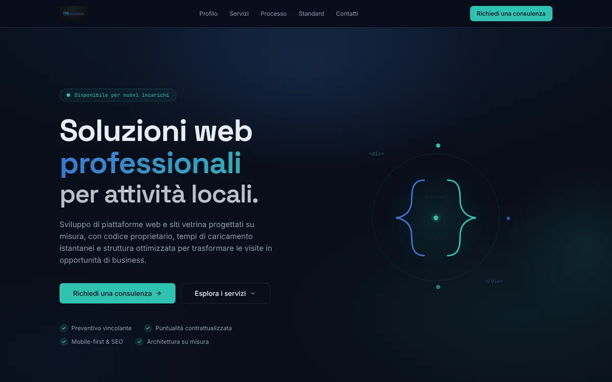

# dinomoldo.dev

Sito one-page per la mia attività freelance di sviluppo web: presentazione, servizi, metodo di lavoro e un form di contatto collegato a un backend Django.

**Online:** [dinomoldo-dev.vercel.app](https://dinomoldo-dev.vercel.app)



## Cosa c'è dentro

- **Frontend e backend separati**: React su Vercel, Django su Railway.
- **Form di contatto completo**: validazione con Django REST Framework, salvataggio nel database, gestione delle richieste dal pannello admin e notifica email tramite l'API di [Resend](https://resend.com). Se l'email non parte, la richiesta resta comunque salvata.
- **CORS e CSRF tra domini diversi**: il frontend legge il cookie `csrftoken` e lo rimanda nell'header `X-CSRFToken`.
- **Contenuti in un solo file**: tutti i testi stanno in `frontend/src/lib/siteConfig.js`, i componenti non contengono copy.

## Stack

| Parte | Tecnologie |
|---|---|
| Frontend | React 18, Vite, Tailwind CSS, shadcn/ui (Radix), lucide-react, Vercel Analytics |
| Backend | Django 5, Django REST Framework, django-cors-headers, WhiteNoise, Gunicorn |
| Servizi | Vercel (frontend), Railway (backend), Resend (email) |

## Avvio in locale

**Backend**

```bash
cd backend
python -m venv venv
source venv/bin/activate          # su Windows: venv\Scripts\activate
pip install -r requirements.txt
python manage.py migrate
python manage.py createsuperuser  # facoltativo, per vedere le richieste in /admin
python manage.py runserver        # http://localhost:8000
```

**Frontend**

```bash
cd frontend
npm install
npm run dev                       # http://localhost:5173
```

In sviluppo Vite inoltra le chiamate a `/api` verso `http://localhost:8000` (vedi `vite.config.js`): con i due server avviati il form funziona subito.

### Variabili d'ambiente del backend

| Variabile | A cosa serve |
|---|---|
| `RESEND_API_KEY` | invio delle notifiche email; senza, le richieste vengono solo salvate |
| `CONTACT_NOTIFICATION_EMAIL` | indirizzo che riceve le notifiche |

Le altre impostazioni (chiave segreta, host consentiti, origini CORS e CSRF) sono in `backend/dinomoldo_backend/settings.py`.

## Come funziona il CSRF con frontend e backend separati

Django protegge le richieste POST con un token CSRF. Con frontend e backend su origini diverse servono due accorgimenti, già configurati:

1. **Backend**: `CORS_ALLOWED_ORIGINS` e `CSRF_TRUSTED_ORIGINS` includono l'origine del frontend e `CORS_ALLOW_CREDENTIALS = True` lascia passare i cookie.
2. **Frontend**: `postJSON` in `frontend/src/lib/utils.js` legge il cookie `csrftoken` e lo inoltra nell'header `X-CSRFToken`, con `credentials: "include"`.

Django imposta il cookie `csrftoken` quando il browser visita una sua pagina o una view con `@ensure_csrf_cookie`. Se frontend e backend vengono serviti dallo stesso dominio, CORS non serve più.

## API

`POST /api/contact/`

```json
{
  "name": "Mario Rossi",
  "email": "mario@esempio.it",
  "phone": "+39 333 1234567",
  "business_type": "ristorante",
  "message": "Vorrei un sito con menu digitale..."
}
```

`business_type` accetta `ristorante`, `negozio` o `altro`; `phone` è facoltativo. Risponde `201` con `{"detail": "Richiesta ricevuta con successo."}` oppure `400` con gli errori campo per campo.

## Struttura

```
frontend/src/
  lib/siteConfig.js        testi, servizi, passaggi del processo, contatti
  lib/utils.js             cn() e helper per CSRF e fetch verso Django
  index.css                colori del brand come variabili HSL
  components/
    ui/                    componenti shadcn (button, card, input...)
    layout/                Navbar, Footer, Logo
    sections/              Hero, About, Services, HowItWorks, WhyTrustMe, Contact
  App.jsx                  ordine delle sezioni

backend/
  dinomoldo_backend/       impostazioni Django, CORS, CSRF
  contact/                 modello ContactRequest, serializer, view POST /api/contact/, admin
```

### Modifiche frequenti

- **Testi**: solo `frontend/src/lib/siteConfig.js`.
- **Colori**: i valori HSL in `:root` dentro `frontend/src/index.css`, mappati su Tailwind da `tailwind.config.js`.
- **Nuova sezione**: crea il componente in `components/sections/`, aggiungi i testi in `siteConfig.js`, inseriscilo in `App.jsx` e, se serve, aggiungi la voce in `siteConfig.nav` con lo stesso `id`.
- **Logo e favicon**: `frontend/public/logo-horizontal.jpeg` (navbar e footer, tramite `Logo.jsx`) e `frontend/public/favicon.jpeg`.
